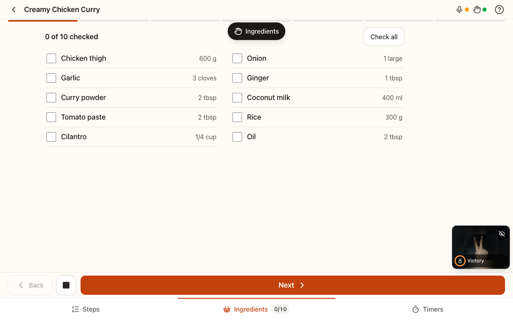
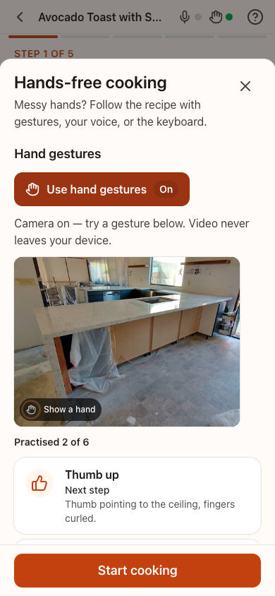
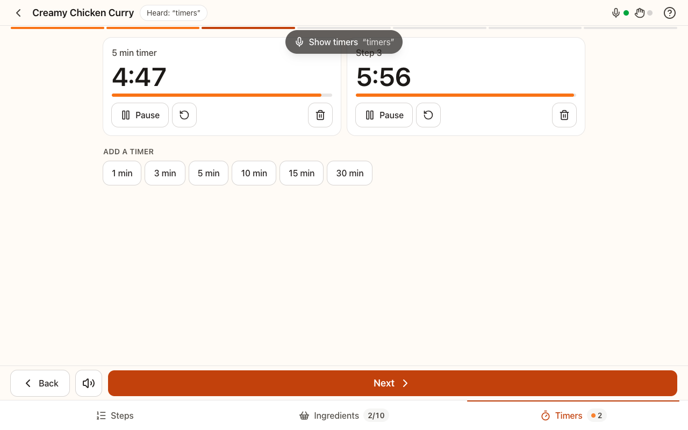

# Culinary Companion

A hands-free recipe app: step through a recipe with hand gestures or your voice while your hands are covered in flour, and have each step read aloud.

**Live demo:** https://culnary-companion-bhy9.vercel.app

## Screenshots



| Learn the gestures on first visit | Voice-started timers |
| --- | --- |
|  |  |

Screenshots are from automated browser runs, where the "camera" is a looped video of hand photos.

## What it does

- Eight real recipes adapted from the [Wikibooks Cookbook](https://en.wikibooks.org/wiki/Cookbook:Table_of_Contents), each with a photo of the actual dish from Wikimedia Commons. Source page, revision, licence and photographer are credited on every recipe.
- Timers on the steps whose instructions state a time. No invented difficulty ratings or totals.
- A cooking mode that shows one step at a time, large and readable from across the kitchen. On a tablet or laptop it also shows the running timers and the ingredients the current step uses.
- Control it by tapping, with the keyboard, by voice, or with hand gestures. Every method triggers the same commands.
- Kitchen timers that keep running when you leave the cooking screen. They chime when they finish, and the cooking screen also announces them aloud.
- Saved recipes and per-recipe progress, kept in your browser.
- A shopping list: add every ingredient from a recipe, tick items off in the shop, and copy the list as plain text. It stays in your browser, separate from the cooking checklist.
- A short hands-free tutorial with live gesture practice, and a help sheet you can open at any time.

## Design

The design direction is **"The Pass"**: the ticket rail of a restaurant kitchen, where orders are read at a glance across a noisy line and called out ("Heard!"). That matches the app's job: read from a metre away, with wet hands, voice first. It uses [Atkinson Hyperlegible Next](https://fonts.google.com/specimen/Atkinson+Hyperlegible+Next) (designed for legibility) for text and its mono cut for every quantity, time and timer. Text is ink on ticket paper, and a single tomato accent is reserved for what is live right now. The full system, with its tokens and the reasoning behind each choice, is in [`DESIGN.md`](DESIGN.md). The audit that led to it is in [`docs/audit/AUDIT.md`](docs/audit/AUDIT.md).

## Hands-free controls

### Hand gestures

Hold the gesture for about half a second. The app fires once, then waits until your hand changes or leaves the frame.

| Gesture | Action |
| --- | --- |
| Thumb up | Next step |
| Thumb down | Previous step |
| Open palm | Read the step again |
| Victory (V sign) | Show or hide ingredients |
| Point up | Start the step timer |
| Fist | Pause or resume the timer |

### Voice commands

Say the phrase on its own, or with filler such as "okay" or "please".

| Say | Action |
| --- | --- |
| "next", "next step", "continue", "go on" | Next step |
| "back", "previous", "go back" | Previous step |
| "repeat", "again", "say that again" | Read the step again |
| "step 3", "go to step 3" | Jump to a step |
| "ingredients", "what do I need" | Show ingredients |
| "steps", "instructions", "method" | Show steps |
| "timer for 7 minutes", "set a timer", "half an hour" | Start a timer |
| "pause timer", "resume timer", "reset timer" | Control the timer |
| "cancel timer", "dismiss timer" | Remove a timer |
| "check garlic", "got the onions", "check all" | Tick ingredients off |
| "uncheck garlic", "uncheck all" | Untick ingredients |
| "stop", "quiet" | Stop talking |
| "help", "what can I say" | Open help |

Matching is by whole words, so "background" never triggers "back".

The grammar only accepts command-shaped phrases, so longer kitchen chatter such as "put the lid back on" or "I'll be right back" is ignored. Short command words said on their own (next, back, stop, again, pause) are always treated as commands.

The microphone pauses while the app is speaking, so it never hears itself. Speak after the read-out finishes, or tap Stop reading.

### Keyboard

| Key | Action |
| --- | --- |
| Right arrow, N | Next step |
| Left arrow, P | Previous step |
| R | Read step again |
| I | Show or hide ingredients |
| T | Start step timer |
| F | Pause or resume timer |
| Esc | Stop talking |
| ? | Help |

## Works without a camera or mic

Nothing asks for the camera or microphone until you turn gestures or voice on. If you decline, or the browser or device does not support them, the app shows a short note and stays fully usable with taps and the keyboard.

## Privacy

Gesture recognition runs in your browser and camera video never leaves your device. Voice commands use the browser's speech service; in Chrome this sends your audio to Google. Saved recipes, progress, settings and your shopping list are stored in your browser's local storage only. There is no account and no backend.

## Browser support

| Feature | Browsers |
| --- | --- |
| Hand gestures | Modern Chrome, Edge, Firefox and Safari with WebAssembly and a camera |
| Voice commands | Chrome, Edge and Safari (not Firefox) |
| Read aloud | All major browsers |

Tested in Chromium on desktop, including a cross-origin iframe. The other browsers listed support the same web APIs but haven't been checked on real devices yet.

## Embedding

The app works inside an iframe. Allow the camera and microphone so gestures and voice can work:

```html
<iframe
  src="https://culnary-companion-bhy9.vercel.app"
  width="800"
  height="520"
  allow="camera; microphone; autoplay"
  title="Culinary Companion"
></iframe>
```

Without the `allow` attribute the browser blocks the camera and microphone, and the app falls back to taps and keys.

## How it works

```
  tap      keys      voice      gestures
   |         |          |           |
   |         |     speech parser    |
   |         |          |      stabilizer (hold to confirm)
   +---------+----------+-----------+
                        |
                     Command
                        |
              one dispatcher (cooking screen)
                        |
          +-------------+--------------+
          |             |              |
   step reducer      timers        speech out
```

Every input becomes a `Command`, and the cooking screen handles commands in exactly one place, so a new input method only needs a translator. A gesture must be held steadily before it fires (the stabilizer), which stops accidental triggers from a hand passing through the frame. The MediaPipe gesture model and its WebAssembly runtime are self-hosted and lazy-loaded, so nothing is downloaded until you turn gestures on. MediaPipe's WebAssembly runtime prints its own native diagnostic lines to the console; the app filters exactly those lines, so real errors still show up.

### Testing

There are over 950 automated tests (`npm test`) covering the voice grammar, the gesture stabilizer, timers, the media hooks, the screens, the shopping list, and the recipe content itself. The content tests check that every timer is backed by a time the step text states, and that every photo is self-hosted and carries a free licence and credit. The core logic was also mutation-tested: deliberately planted bugs were run against the suite, and tests were added for the ones it missed. On top of that, browser probes ran in Chromium with fake camera and microphone devices. They covered real MediaPipe recognition of all six gestures from photos, voice through a stand-in for the browser speech service, the permission-denied UI, and a cross-origin iframe with and without camera and microphone permission.

## Tech stack

React 18, TypeScript, Vite, Tailwind CSS 4, React Router 7, lucide-react, MediaPipe Tasks Vision (Gesture Recognizer), Web Speech API, Web Audio, Vitest and Testing Library.

## Getting started

Requires Node 20 or newer.

```bash
npm ci
npm run dev      # start the dev server
npm test         # run the unit and component tests
npm run build    # typecheck and build for production
```

## Project structure

```
src/
  lib/          pure logic: commands, voice parser, gestures, keyboard, timers, storage
  hooks/        gesture recognition, speech recognition and speech synthesis hooks
  context/      recipes (saved, progress) and kitchen timers
  screens/      home, recipe, cooking, search, saved, in progress, settings
  components/   shared UI: ui/ primitives (ticket, buttons, labels), nav, recipe tickets, cooking/ (cooking mode)
  styles/       design tokens (Tailwind @theme), see DESIGN.md
  data/         recipe content (adapted from Wikibooks) and its contract
content/        raw source wikitext + metadata per recipe, and the licence notes
scripts/        fetch-content.mjs (re-fetch sources and photos), copy-mediapipe-wasm.mjs
public/
  recipes/      recipe photos (1200 px and 600 px webp)
  models/       MediaPipe gesture recognizer model
  mediapipe/    self-hosted WebAssembly runtime (copied from node_modules at build)
```

## Credits

- Hand gesture model: Google MediaPipe Gesture Recognizer, Apache-2.0.
- Recipes: adapted from the Wikibooks Cookbook (Wikibooks contributors) under [CC BY-SA 4.0](https://creativecommons.org/licenses/by-sa/4.0/). The adapted recipe text in `src/data/recipes.ts` and `content/` is therefore CC BY-SA 4.0. Each recipe links its source page and exact revision in the app.
- Food photos: Wikimedia Commons, each under its own free licence (CC BY-SA or CC0). Credited per photo in the app and in `content/sources/*.meta.json`.
- Fonts: Atkinson Hyperlegible Next and Atkinson Hyperlegible Mono by the Braille Institute, SIL Open Font License 1.1.

## Course context

Originally built for CS3483 Multimodal Interface Design.
